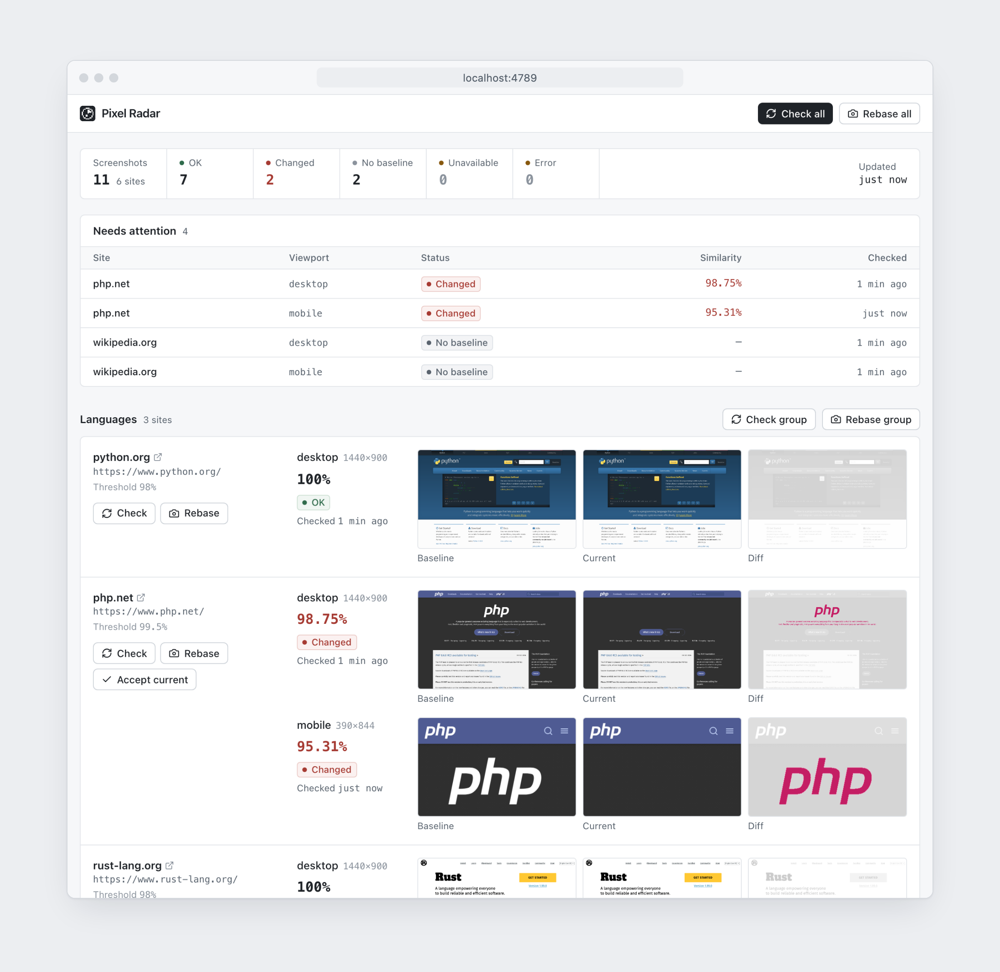

# Pixel Radar


A self-hosted visual monitor for any website: it screenshots your pages with Playwright, compares
them with approved baselines pixel by pixel and flags the ones that changed.



## Why

- A plugin update, a CSS deploy or a third-party script can break a layout without any error or
  failed uptime check.
- Opening dozens of sites by hand after every release does not scale and misses small shifts.
- A pixel diff with a similarity score turns "does it look the same?" into a number you can alert on.

## Install

Requires Node.js 20.19+ or 22.12+.

```sh
git clone https://github.com/plazorax/pixel-radar.git && cd pixel-radar
npm install
npx playwright install chromium
cp sites.example.json sites.json
```

## Usage

List your sites in `sites.json`, grouped however you like:

```json
{
  "minSimilarity": 0.98,
  "viewports": { "desktop": { "width": 1440, "height": 900 }, "mobile": { "width": 390, "height": 844 } },
  "groups": {
    "Storefront": ["https://shop.example.com/", { "url": "https://shop.example.com/cart", "hide": ["#cookie-banner"] }],
    "Docs": ["https://docs.example.com/"]
  }
}
```

```sh
npm run rebase            # capture the first baselines
npm run check             # compare; exits 1 if anything changed or is down
npm run build && npm start  # dashboard on http://127.0.0.1:3000
```

Set `PIXEL_RADAR_PASSWORD` to require a login. Options, cron and CI setups are in
[configuration](docs/configuration.md) and [CLI, cron and CI](docs/cli.md).

## Features

- Grouped sites, several named viewports per site, optional full-page capture.
- pixelmatch comparison with a similarity score, changed-pixel count and a diff image.
- Statuses: OK, Changed, No baseline, Unavailable (network error or HTTP 4xx/5xx), Error.
- Check or rebase one site, a group or everything; accept a reviewed capture as the new baseline.
- `hide` and `mask` selectors, per-site thresholds and retries to reduce false alarms.
- Stale-check warnings, optional cron schedule and password login with signed cookies.
- Dashboard with status counts, a "Needs attention" table and a baseline/current/diff viewer;
  React, TypeScript and Tailwind CSS, served by the same Node.js process.

## Status

v0.1.0 — reference implementation. Chromium only, state in one JSON file, no notifications or
result history yet; dynamic pages need `hide`/`mask` tuning. See [how it works](docs/how-it-works.md),
[deployment](docs/deployment.md) and [development](docs/development.md).

## License

[MIT](LICENSE) © 2026 Oleksii Shaposhnikov
